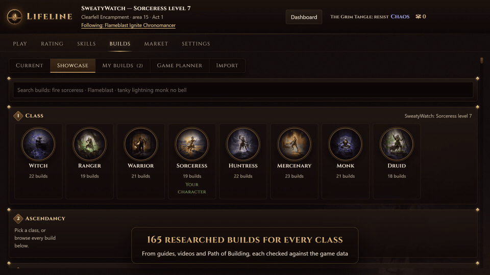

# Lifeline

<p align="center">
  <a href="docs/media/lifeline-showcase.mp4"></a>
  <br>
  <b><a href="docs/media/lifeline-showcase.mp4">▶ Watch the full tour (1:34)</a></b>
</p>

<p align="center">
  <a href="https://github.com/RCFromCLE/Lifeline/releases/latest"></a>
  <br>
  <a href="https://github.com/RCFromCLE/Lifeline/releases/latest"><b>Download the latest release</b></a> · Windows 10/11
</p>

**Builds, passives and skills for Path of Exile 2**, built for hardcore. Lifeline does three things:

- **Builds.** 165 researched builds across all 8 classes, sourced from guides, videos and Path of Building and checked against the current game data. Search them, read each one's plan and sources, and send a build straight into the game's own **Build Planner**.
- **Passives.** It reads your game log, so it knows which passives you've taken. It shows the next ones to take, in order, on a numbered tree, and which stat to pick on every attribute node. An optional overlay shows the next passive over the game and chimes when you take one on your plan.
- **Skills.** The skills and support gems for each stage of the campaign: only supports you can cut at that point and that fit your weapon. Plus rotations named for your controller or keys.

It never touches the game. It reads the game's log file and Build Planner folder, and writes build files into that folder only when you ask.

## What's in it

**Builds**
- Search as you type: class, ascendancy, skill, damage type or traits ("tanky", "cheap", "hardcore safe"). "no bell" or "no minions" hides builds that use them.
- Or pick step by step: class → ascendancy → what matters (damage or tanky, style, budget, complexity), with a % fit for each build.
- Every build is rated for damage, tankiness, clear speed, bossing, hardcore safety, budget and complexity.
- Every build shows which game patch its guide is for, when it was published, and its version history, with links to every source.
- Featured builds have an act-by-act plan (skills and supports with the level to start each, passives, ascendancy order, gear and boss tips) and a step-by-step boss rotation.
- **Create full build** plans every stage from Act 1 to Endgame for any build in the list.
- **Import** a Path of Building code or link.
- **Send to game planner** writes each stage into Path of Exile 2's Build Planner. You can also follow or delete the builds already in there.

**Passives**
- How much of the plan you've taken, the next passives in order, and anything off-plan.
- The passive tree with the plan numbered in the order to take it, stage by stage.
- The stat (Strength, Dexterity or Intelligence) to pick on each "+5 to any Attribute" node, worked out from the plan's gems and gear goals.

**Skills**
- The skills and supports to socket for your current stage.
- **Suggest skills & rotations**: which button each skill goes on, why each support is there, and rotations for clearing, bossing and emergencies.

**Dashboard**
- A second-screen view of your skills, supports and next passives. Hover a notable to see what it does.

**In game** (optional, Settings → In game)
- A small overlay shows the next passive to take while Path of Exile 2 is in front, with a symbol for minor, major (notable) and keystone passives and the stat to pick on attribute nodes.
- Its **Skills** button opens the skills and supports for your current stage.
- A chime plays when you take a passive on your plan (with a preview button in Settings).
- Unlock it to drag it anywhere, then lock it: it stays there, even after a restart. It never takes focus from the game.

## Do I need a Claude subscription?

No. Two buttons use AI, and they run on your own Claude Pro or Max plan through Claude Code (no API key, no extra bill):

- **Create full build**
- **Suggest skills & rotations**

Everything else works without it: the build list, search, build pages, Path of Building import, the game planner, passive tracking, the tree and the dashboard.

## Install

You need **Windows 10 or 11** and **Path of Exile 2** (Steam on any drive, or the standalone client).

1. Go to **https://github.com/RCFromCLE/Lifeline/releases/latest**. Under **Assets**, download **`Lifeline_<version>_x64-setup.exe`**.
2. Double-click it. If Windows shows **"Windows protected your PC"**, click **More info → Run anyway** (the installer isn't code-signed yet).
3. Click through the installer. It installs just for your user, so it doesn't need admin rights.
4. Start **Lifeline** from the Start menu.

On first start, a short welcome asks how you play (PlayStation controller, Xbox controller, or mouse and keyboard) and offers to connect Claude. You can skip that step and connect later from **Settings → Welcome tour**.

<details><summary>Prefer to set up Claude Code by hand?</summary>

```powershell
winget install --id Git.Git -e           # Git for Windows (Claude Code uses it)
irm https://claude.ai/install.ps1 | iex  # Claude Code
claude auth login --claudeai             # sign in with your Claude account (opens the browser)
```
</details>

### Good to know

- **Game log:** found automatically in any Steam library or the standalone folder. If Lifeline says it wasn't found, start the game once; the app keeps checking.
- **Passives come from the log.** Lifeline sees a passive when you allocate it while the log is being written, so it knows about passives taken since you started playing that character on this PC.
- **Gems aren't in the log.** The skills shown are the plan to socket, not what you have socketed.
- **The overlay** shows only while the game is the window in front. Play in Windowed Fullscreen; exclusive fullscreen hides it.
- **Your data** lives in `%APPDATA%\com.rudyc.lifeline` and is separate on each PC.

### Updating and uninstalling

- **Update:** the app tells you when a new release is out. Download the newest `…_x64-setup.exe` and run it; your saved builds and settings are kept.
- **Uninstall:** Windows Settings → Apps → Installed apps → **Lifeline** → Uninstall.

### Upgrading from 0.5 or earlier

Version 0.6 narrowed Lifeline to builds, passives and skills. Chat, item checks, rating, the market and Travel, gear recording, zone resistances, the in-game HUD, hotkeys and sound cues were removed (0.6.1 brings back a small next-passive overlay and a chime; both can be turned off in Settings). Your saved builds and the build you follow carry over. Old chats, ratings and recorded gear stay on disk in `%APPDATA%\com.rudyc.lifeline` but are no longer used; you can delete `conversations.json`, `rating.json` and `equipped.json` there.

### Troubleshooting

- **Create full build or Suggest skills fails, or says Claude Code isn't found:** open a new PowerShell and run `claude --version`. If that fails, install Claude Code (Settings → Welcome tour). If it works, run `claude` once to make sure you're still logged in.
- **Anything else:** the app writes a diagnostics log to `%APPDATA%\com.rudyc.lifeline\debug.log`.

## For developers

```
Cargo.toml                 Rust workspace
crates/
  lifeline-gamefiles/      files the PoE2 client reads and writes: BuildPlanner/*.build, logs/Client.txt events
  lifeline-pob/            Path of Building codes and share links, build XML, stage classification
  lifeline-data/           GGG's passive-tree export and RePoE game data (gems, supports, bases, mods)
  lifeline-model/          the build list, PoB build → stages → in-game .build files, attribute picks, support rules
  lifeline-ai/             runs your own Claude Code CLI for the two AI jobs (build architect, skill coach)
app/
  src-tauri/               the desktop app (Tauri 2): log watcher, build import and export, tool server
  ui/                      main window and dashboard (HTML/CSS/JS)
```

Building needs Rust (stable, via rustup), the Visual Studio 2022 Build Tools ("Desktop development with C++") and the WebView2 runtime (already on Windows 11).

```powershell
cargo test --workspace                          # offline tests
cargo build --release -p lifeline-app           # dev build: .\target\release\Lifeline.exe
cargo install tauri-cli --version "^2" --locked
cd app\src-tauri; cargo tauri build             # installer: target\release\bundle\nsis\*-setup.exe
```

**Publishing a version:** bump `version` in `app/src-tauri/tauri.conf.json` and in `[workspace.package]` of the root `Cargo.toml`, commit, then `git tag vX.Y.Z; git push origin main --tags`. GitHub Actions builds the installer and attaches it to that tag's release, with checksums and signed build provenance.

[PLAN.md](PLAN.md) is the original, much broader plan and research notes; the app has since been narrowed to what's described here.

## License and disclaimer

Lifeline is free software under the [MIT License](LICENSE). It is provided **as is, without warranty of any kind**, and you use it **at your own risk**. Its author isn't liable for any loss or damage from using it, including (but not limited to) dead hardcore characters, problems with your computer or data, or action taken against your account by Grinding Gear Games. Build data and AI suggestions can be wrong: check before you act on them. Using it within Path of Exile 2's terms of service is your responsibility.

Found a security problem? See [SECURITY.md](SECURITY.md).

*This product isn't affiliated with or endorsed by Grinding Gear Games in any way.*
